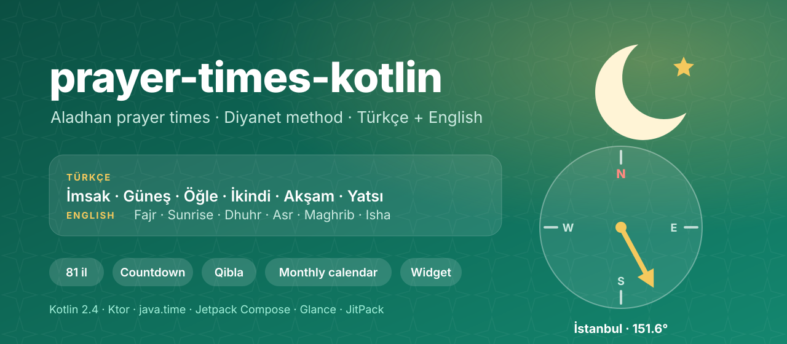
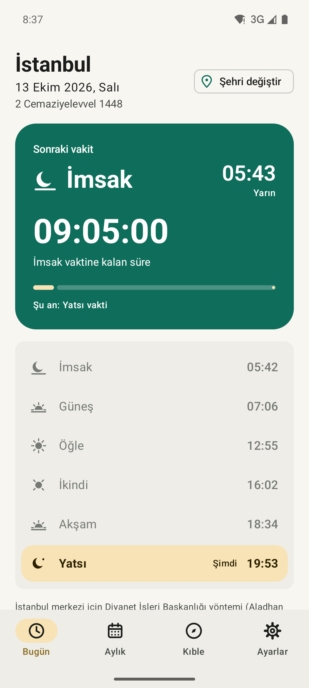
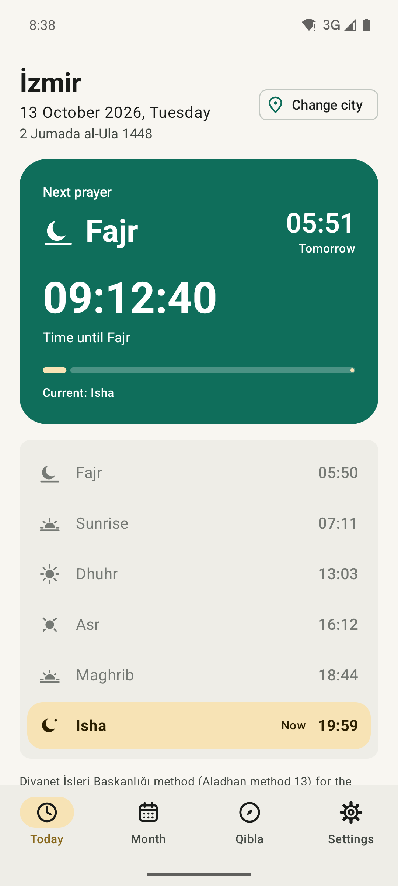
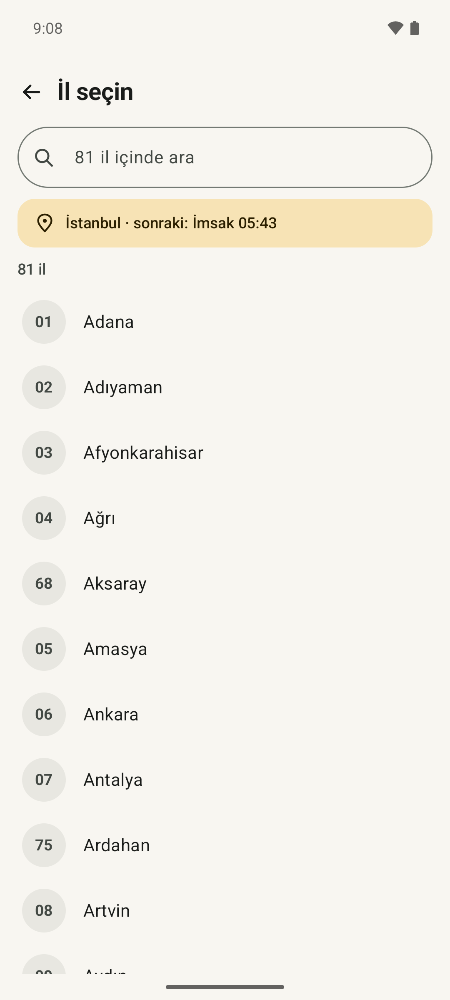
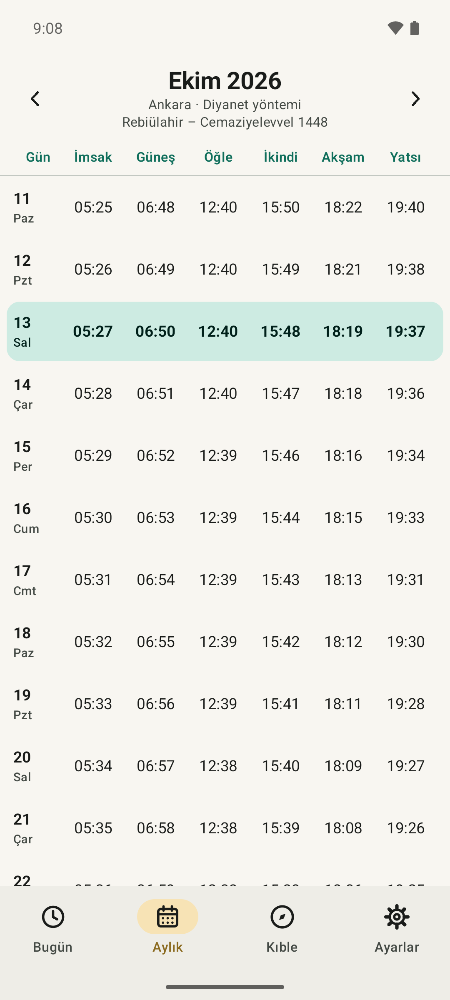
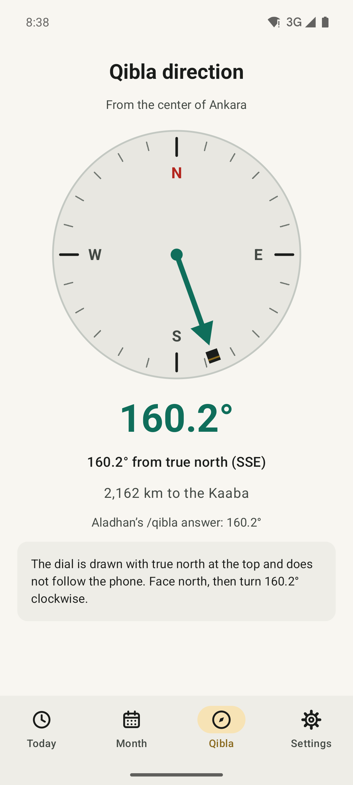
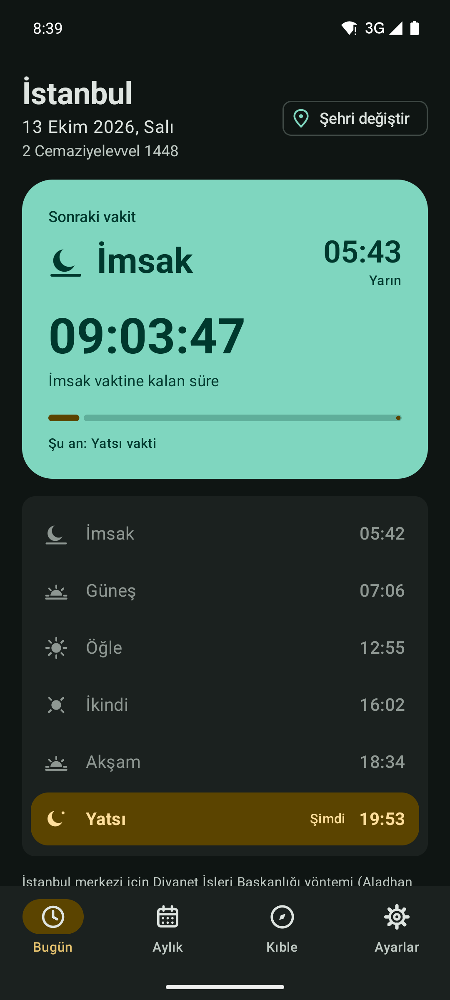
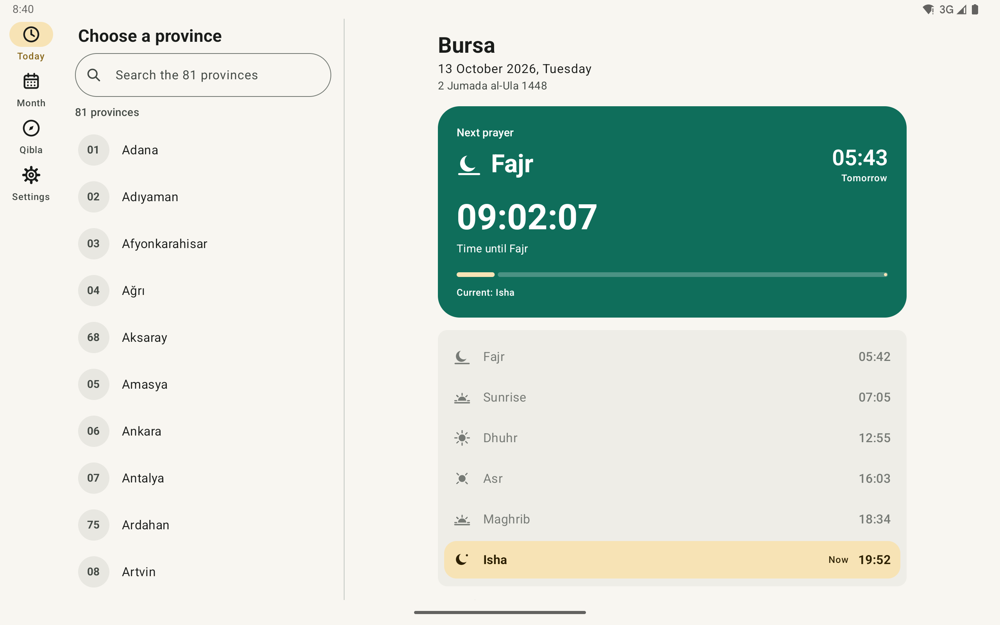

<p align="center">
  
</p>

<p align="center">
  <a href="https://github.com/halilozel1903/prayer-times-kotlin/actions/workflows/ci.yml"></a>
  <a href="https://jitpack.io/#halilozel1903/prayer-times-kotlin"></a>
  
  
  
  
  
  
  <a href="LICENSE"></a>
</p>

**prayer-times-kotlin** is a Kotlin client for the free [Aladhan prayer times API](https://aladhan.com/prayer-times-api). It defaults to the method of Turkey's Presidency of Religious Affairs (Diyanet İşleri Başkanlığı, Aladhan method 13). It returns typed `java.time` models and works out the next prayer with a live countdown. It also computes the Qibla bearing offline and bundles Turkey's 81 provinces (iller) with plate codes, center coordinates and search that handles Turkish letters. The core is pure Kotlin/JVM (Ktor and kotlinx.serialization). An optional Android module schedules exact-alarm reminders. The sample is a Compose app for phones and tablets, fully in **Turkish and English** with an in-app language switch. In it you pick one of the 81 provinces and get a countdown to the next prayer (ezan vakti), a monthly calendar, the Qibla direction, a home screen widget and reminders.

```kotlin
val client = PrayerTimesClient()                          // Diyanet method (13) by default

val istanbul = TurkeyProvinces.byPlate(34)                 // Province(34, "İstanbul", 41.0082, 28.9784)
val today = client.timings(istanbul)                       // PrayerTimes, ZonedDateTime in Europe/Istanbul
today.maghrib                                              // ZonedDateTime, e.g. 2026-10-13T18:34+03:00[Europe/Istanbul]
today.hijri.format("tr")                                   // "2 Cemaziyelevvel 1448"

val next = client.schedule(istanbul).next(Instant.now())!! // today + tomorrow, so it works after Yatsı too
"${next.next.prayer.turkishName} ${next.countdown}"        // "Akşam 02:13:05"

Qibla.bearing(istanbul)                                    // 151.62 (degrees from true north)
TurkeyProvinces.search("sanliurfa")                        // [63 Şanlıurfa]
```

## Screenshots

Captured by CI on Android emulators with the sample app. **Every screen shows real prayer times loaded live from api.aladhan.com on the day of the run.** No fixtures or fallback data are used. A scene that fails to load fails the job instead of producing a picture. The status bar clock shows the real time in Turkey, so it matches the countdown.

| Bugün, İstanbul (Türkçe) | Today, İzmir (English) | 81 il, search |
| :---: | :---: | :---: |
|  |  |  |

| Aylık takvim, Ankara | Qibla, Ankara | Dark mode |
| :---: | :---: | :---: |
|  |  |  |

**Tablet:** a navigation rail, the province list and the selected province (Bursa) side by side.



The Qibla screenshot shows the bearing computed for Ankara, drawn on a dial with true north at the top. An emulator has no real compass, so the screenshot does not pretend to show a live compass. On a phone with a rotation vector sensor the dial turns with the device, corrected for magnetic declination.

## Features

- **Aladhan client**: `timings` by coordinates or by province, `timingsByCity`, `calendar` and `calendarByCity` for a month, and `qibla`. Every call is a main-safe `suspend` function.
- **Diyanet by default**: method 13 (Fajr 18°, Isha 17°). Any Aladhan method, the Hanafi or standard Asr (`School`) and per-time minute offsets (`Tune`) can be set.
- **Typed `java.time` models**: `ZonedDateTime` in the place's own time zone, `LocalDate`, the Hijri date with Turkish and English month names, and the calculation `meta`. The night times (midnight, last third) land on the right date.
- **Next prayer and countdown**: `PrayerSchedule.next(now)` gives the next time, the current one, the remaining `Duration`, a `HH:MM:SS` countdown and the progress between the two. It works across midnight and before İmsak.
- **Qibla**: the great circle bearing to the Kaaba computed offline. It agrees with Aladhan's `/qibla` endpoint (151.6° in İstanbul, 160.2° in Ankara). Distance to the Kaaba, relative bearing for a compass, and the 16-point compass name are included too.
- **Turkey's 81 provinces**: name, plate code (1–81) and the coordinates of each provincial center. Search ignores case and Turkish letters (İ/ı, ş, ğ, ü, ö, ç, â), the same on any device locale, and a plate code works as a query. You also get Turkish alphabetical order, Turkish upper case and the nearest province to a point.
- **Prayer names in both languages**: `Prayer.Fajr.turkishName` is `"İmsak"` and `englishName` is `"Fajr"`, through `"Yatsı"` / `"Isha"`.
- **Reminders (Android module)**: `PrayerReminderScheduler` sets one exact alarm for the next occurrence of each prayer, optionally some minutes early. It also handles the exact alarm permission flow and falls back to inexact alarms.
- **Errors**: `PrayerTimesException.Network`, `Http`, `Api` (Aladhan's own message, for example for an unknown city) and `Decoding`.
- **Caching and pluggable HTTP**: successful answers are kept in memory by url. Ktor with CIO by default; pass OkHttp, a `MockEngine` or your own `PrayerTimesTransport`.
- **Explicit API**, unit tested against Aladhan responses for İstanbul and Ankara.

## Installation

Add JitPack to `settings.gradle.kts`:

```kotlin
dependencyResolutionManagement {
    repositories {
        google()
        mavenCentral()
        maven("https://jitpack.io")
    }
}
```

Then the dependency:

```kotlin
dependencies {
    implementation("com.github.halilozel1903.prayer-times-kotlin:prayertimes:1.0.0")

    // Optional, Android: exact-alarm prayer reminders.
    implementation("com.github.halilozel1903.prayer-times-kotlin:prayertimes-android:1.0.0")

    // Optional: use OkHttp instead of Ktor's CIO engine.
    implementation("io.ktor:ktor-client-okhttp:3.6.0")
}
```

> The build is also set up for Maven Central (`io.github.halilozel1903:prayertimes`) via the vanniktech publish plugin.

`prayertimes` is a plain Kotlin/JVM library (JDK 17+), so it also works on a server or in a desktop app.

## Usage

**Create a client**

```kotlin
val client = PrayerTimesClient {
    method = CalculationMethod.Diyanet         // the default; or MuslimWorldLeague, Isna, CalculationMethod(15), ...
    school = School.Standard                   // or School.Hanafi for a later Asr
    tune = Tune(fajr = 1, isha = -1)           // minute offsets, sent as tune=
    engine = OkHttp.create()                   // default: CIO
    cacheSize = 64                             // answers kept in memory, by url
    retries = 2                                // network errors and 5xx, with backoff
}
// ...
client.close()
```

Create one client and share it. It is safe to use from many coroutines.

**Times for a day**

```kotlin
val ankara = TurkeyProvinces.byPlate(6)
val day = client.timings(ankara, LocalDate.of(2026, 10, 13))

day.fajr          // İmsak (Diyanet) = Aladhan's Fajr
day.sunrise       // Güneş
day.dhuhr         // Öğle
day.asr           // İkindi
day.maghrib       // Akşam
day.isha          // Yatsı
day.times         // all six as List<PrayerTime>, in order
day[Prayer.Asr]   // by prayer
day.midnight      // the night after Maghrib, on the next date
day.meta.methodName   // "Diyanet İşleri Başkanlığı, Turkey (experimental)"

// Anywhere in the world, by coordinates (Aladhan finds the time zone) or by name:
client.timings(52.52, 13.405, LocalDate.now())
client.timingsByCity("Berlin", "Germany")
```

> **İmsak:** Diyanet's İmsak is the start of Fajr, which is Aladhan's `Fajr` with method 13. Aladhan's separate `Imsak` field (10 minutes earlier) is available as `day.imsak` but is not shown as İmsak in Turkish calendars.

**Next prayer and countdown**

```kotlin
val schedule = client.schedule(istanbul)            // today and tomorrow, fetched in parallel
val next = schedule.next(Instant.now())!!

next.next.prayer        // Prayer.Maghrib
next.next.time          // 18:34 today (or tomorrow's İmsak after Yatsı)
next.current?.prayer    // Prayer.Asr (before İmsak: last night's Isha)
next.remaining          // Duration
next.countdown          // "02:13:05"
next.progress           // 0.0..1.0 from the current time to the next

PrayerSchedule(days, includeSunrise = false)        // count down to prayers only, skipping Güneş
```

In Compose, tick once a second and read `schedule.next(now)`. The sample's `rememberNow()` does this.

**A month**

```kotlin
val october = client.calendar(ankara, YearMonth.of(2026, 10))   // 31 PrayerTimes
october.map { it.date to it.isha.toLocalTime() }
october.first().hijri.month     // HijriMonth.RabiAlThani -> "Rebiülahir" / "Rabi al-Thani"
```

**Provinces and search**

```kotlin
TurkeyProvinces.all.size                 // 81, by plate code
TurkeyProvinces.alphabetical             // Turkish order: ..., Bursa, Çanakkale, Çankırı, ..., Iğdır, Isparta, İstanbul, ...
TurkeyProvinces.byPlate(35)              // İzmir
TurkeyProvinces.byName("IGDIR")          // Iğdır
TurkeyProvinces.search("izmir")          // [İzmir]
TurkeyProvinces.search("kır")            // [Kırıkkale, Kırklareli, Kırşehir, Çankırı, Diyarbakır, Tekirdağ]
TurkeyProvinces.search("06")             // [Ankara]
TurkeyProvinces.nearest(lat, lng)        // preselect from the user's location

TurkishText.fold("Şanlıurfa")            // "sanliurfa", independent of the device locale
```

**Qibla**

```kotlin
Qibla.bearing(41.0082, 28.9784)          // 151.62 degrees from true north
Qibla.bearing(TurkeyProvinces.byPlate(6))   // 160.17
Qibla.distanceKm(41.0082, 28.9784)       // ~2405
Qibla.compassPoint(151.62)               // "SSE"
Qibla.relativeBearing(qibla, heading)    // where to point an arrow for a compass heading (true north)
client.qibla(41.0082, 28.9784)           // Aladhan's answer, for comparison
```

A phone compass measures magnetic north. Add `GeomagneticField(...).declination` to its heading before using `relativeBearing`, as the sample does.

**Reminders (Android)**

```kotlin
val scheduler = PrayerReminderScheduler(context, PrayerAlarmReceiver::class.java)
if (!scheduler.canScheduleExactAlarms()) {
    scheduler.exactAlarmSettingsIntent()?.let { context.startActivity(it) }   // Android 12+: let the user allow it
}
scheduler.schedule(client.schedule(istanbul), minutesBefore = 10, label = "İstanbul")

class PrayerAlarmReceiver : BroadcastReceiver() {
    override fun onReceive(context: Context, intent: Intent) {
        val reminder = PrayerReminderScheduler.reminderOf(intent) ?: return
        // show a notification for reminder.prayer at reminder.time, then schedule again
    }
}
```

**Errors**

```kotlin
try {
    client.timingsByCity("Atlantis", "Turkey")
} catch (e: PrayerTimesException.Api) {
    e.code; e.reason          // Aladhan's code (for example 400) and message
} catch (e: PrayerTimesException.Network) {
    // offline or timed out
}
```

### API

| Aladhan endpoint | Function | Returns |
| --- | --- | --- |
| `GET /timings/{DD-MM-YYYY}?latitude=&longitude=` | `timings(lat, lng, date, timezone)`, `timings(province, date)` | `PrayerTimes` |
| `GET /timingsByCity/{DD-MM-YYYY}?city=&country=` | `timingsByCity(city, country, date, state)` | `PrayerTimes` |
| `GET /timings/...` x 2 (today, tomorrow) | `schedule(lat, lng, date)`, `schedule(province, date)` | `PrayerSchedule` |
| `GET /calendar/{year}/{month}?latitude=&longitude=` | `calendar(lat, lng, month, timezone)`, `calendar(province, month)` | `List<PrayerTimes>` |
| `GET /calendarByCity/{year}/{month}?city=&country=` | `calendarByCity(city, country, month)` | `List<PrayerTimes>` |
| `GET /qibla/{latitude}/{longitude}` | `qibla(lat, lng)` | `Double` |
| Every request | `method=`, `school=`, `tune=` from the config | |

| Offline helper | What it does |
| --- | --- |
| `PrayerSchedule` | `next(now)`, `current(now)`, `dayOf(instant)` over consecutive days |
| `NextPrayer` | `next`, `current`, `remaining`, `countdown`, `progress` |
| `Prayer` | `Fajr`, `Sunrise`, `Dhuhr`, `Asr`, `Maghrib`, `Isha` with `turkishName`, `englishName`, `displayName(lang)` |
| `HijriDate`, `HijriMonth` | Hijri day, month and year; `format("tr")` gives "2 Cemaziyelevvel 1448" |
| `Qibla` | `bearing`, `distanceKm`, `relativeBearing`, `compassPoint` |
| `TurkeyProvinces` | `all`, `alphabetical`, `byPlate`, `byName`, `search`, `nearest`, `zone` |
| `TurkishText` | `fold`, `collator`, `uppercase` |
| `PrayerReminderScheduler` (Android) | `schedule`, `cancel`, `cancelAll`, `canScheduleExactAlarms`, `exactAlarmSettingsIntent`, `reminderOf` |

## Sample app

The `sample` module is a prayer times app in **Turkish and English**:

- **Language**: all text is in `values/strings.xml` (English) and `values-tr/strings.xml` (Türkçe). You can switch between Türkçe, English and the system language inside the app (Settings). The switch uses `AppCompatDelegate.setApplicationLocales`, which uses the system's per-app languages on Android 13+ (`res/xml/locales_config.xml`, also listed in system Settings) and AppCompat's own storage below that.
- **Bugün / Today**: the province, the Gregorian and Hijri dates, the next prayer with a live `HH:MM:SS` countdown and a progress bar, and the six times with the current one highlighted.
- **İl seçimi / Province picker**: all 81 provinces with plate codes in Turkish alphabetical order, with search that ignores Turkish letters.
- **Aylık / Month**: a table for the whole month with today highlighted and the Hijri months it spans.
- **Kıble / Qibla**: the computed bearing on a dial, the distance to the Kaaba and Aladhan's answer for comparison. With a rotation vector sensor the dial follows the phone. Without one the screen says so instead of faking a compass.
- **Ayarlar / Settings**: language, reminders (at the time or 5/10/15 minutes before, with the exact alarm permission flow) and a note on the data.
- **Widget**: a Glance home screen widget with the next prayer and today's times for the chosen province.
- **Tablets**: a navigation rail, the province list and the selected tab side by side.

The data is always live from Aladhan, for the center of the chosen province, through OkHttp.

For screenshots it opens a fixed screen from an intent extra (used by `scripts/screenshots.sh`):

```bash
./gradlew :sample:installDebug
adb shell am start -n io.github.halilozel1903.prayertimes.sample/.MainActivity --es scene today-tr
```

The `scene` extra takes these values:

- `today-tr`: İstanbul in Turkish
- `today-en`: İzmir in English
- `city-picker-tr`: the 81 il list in Turkish
- `month`: Ankara's month in Turkish
- `qibla`: Ankara in English
- `tablet`: Bursa in English

A scene switches the app language the same way the settings screen does and loads today's times live. It logs `SCENE_READY` only when the data is on screen and `SCENE_FAILED` when Aladhan cannot be reached. CI captures the phone scenes on a Pixel 7 and `tablet` on a Pixel Tablet in landscape. The job fails when a scene fails, does not finish loading, misses its expected text or is blank.

## Accuracy

Aladhan computes times astronomically from the method's angles. Diyanet publishes its own official tables, which can differ from Aladhan's by a minute or two. Aladhan applies default offsets for method 13; adjust with `Tune` if you compare with a specific table. Times are for the coordinates of each provincial center; districts far from the center differ slightly. For religious obligations, rely on Diyanet's official calendar.

## Project structure

| Module | What it is |
| --- | --- |
| `prayertimes` | Pure Kotlin/JVM: `PrayerTimesClient`, models, `PrayerSchedule`, `Qibla`, `TurkeyProvinces`, `TurkishText`. Published as `prayertimes` |
| `prayertimes-android` | Android: `PrayerReminderScheduler` for exact-alarm reminders. Published as `prayertimes-android` |
| `sample` | The Turkish and English Compose app with widget and reminders, for phones and tablets, with screenshot scenes |

## Tech stack

Kotlin 2.4 · Ktor 3.6 (CIO, OkHttp) · kotlinx.serialization · kotlinx.coroutines · java.time · AGP 9.4 with built-in Kotlin · Gradle 9.6 · Jetpack Compose (BOM 2026.09) · Material 3 · Glance · AppCompat per-app languages · GitHub Actions with Android emulators

## Credits

Prayer times and the Qibla endpoint come from [Aladhan](https://aladhan.com), a free API. Please keep requests reasonable; the client caches answers in memory. This project is not affiliated with Aladhan or with the Presidency of Religious Affairs of Turkey (Diyanet İşleri Başkanlığı).

## License

MIT. See [LICENSE](LICENSE).
